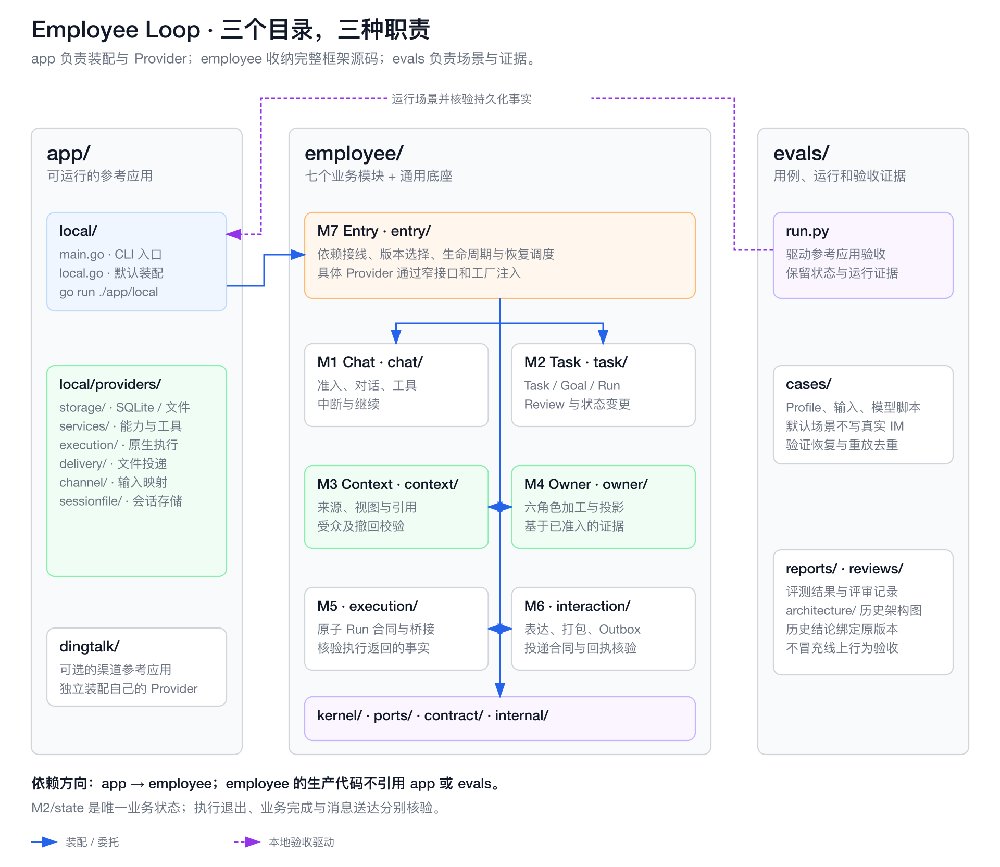

# Eino Employee Loop

[English](README.md)

基于 [CloudWeGo Eino](https://github.com/cloudwego/eino) 的 Employee Loop。
仓库只有三个部分：

```text
app/                         可运行的参考应用，以及各自的具体 Provider
├── local/                   SQLite + Markdown + Eino + 本地执行和投递
└── dingtalk/                轻量钉钉通道接入例子

employee/                    可嵌入的 Employee Loop 框架
├── chat/                    M1  前台对话与业务命令
├── task/                    M2  Worker、Review、计时和 Task/Goal/Run 状态
├── context/                 M3  授权上下文与冻结来源视图
├── owner/                   M4  六类基于原文证据的 Owner 加工
├── execution/               M5  原子 Run 桥接与执行合同
├── interaction/             M6  表达、Outbox 与投递合同
├── entry/                   M7  生命周期与模块装配
├── kernel/                  通用 Eino 运行和决策能力
├── ports/                   外部服务与持久化接口
├── contract/                身份、配置、输入、失败等共享值
├── internal/                框架内部辅助
└── docs/                    当前框架指南与合同

evals/                       用例、评测入口和带版本的证据
```



在仓库根目录运行本地应用，使用新的状态目录：

```sh
go run ./app/local -profile evals/cases/local/allloops-profile.json -dir /tmp/el-demo -script evals/cases/local/allloops-script.json replay -in evals/cases/local/allloops-input.ndjson
```

脚本替换模型决策，存储和文件效果实际执行。`local-file` 回执只证明本地写入，
不能当作钉钉消息送达或完整线上 Buddy 行为还原。

- [架构与 import 迁移](ARCHITECTURE.md)
- [运行本地参考应用](app/local/README.md)
- [嵌入与装配框架](employee/docs/module-composition.md)
- [行为合同](employee/docs/specs/README.md)
- [评测用例与证据](evals/README.md)

其他应用从 `employee/entry` 嵌入框架并提供自己的 Provider；`app/local` 是可执行程序，
不作为应用库导入。MIT 许可。
