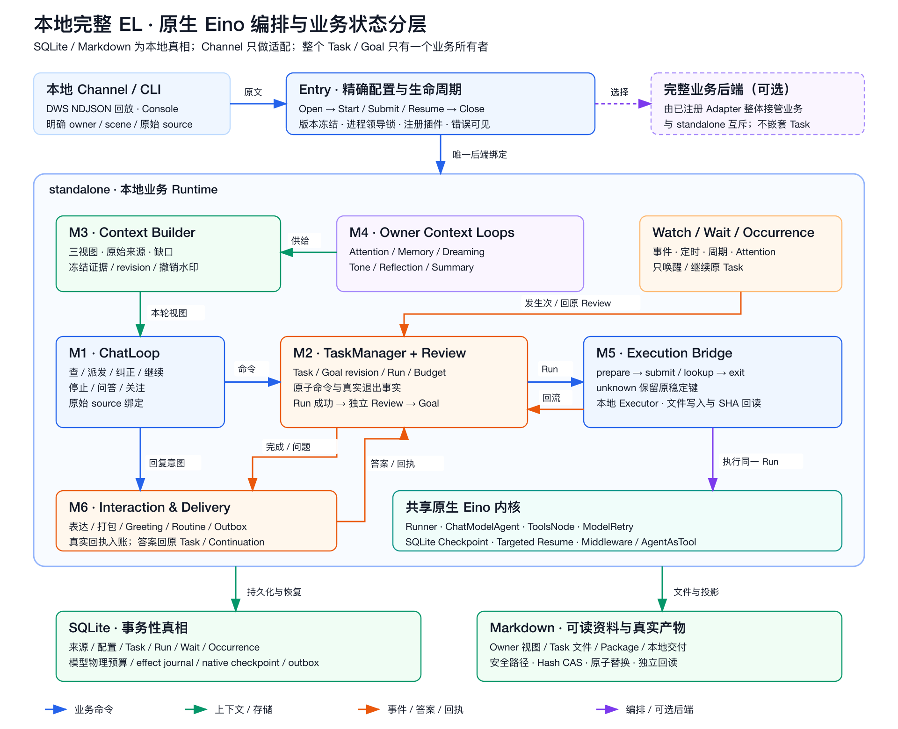

# 本地完整 EL 与 Eino 原生能力复审

本页复审新增 `entry` standalone Runtime。旧兼容 `loop` 的历史结论仍见
[390746f 基线审查](2026-10-24-eino-feature-review.md)，不能将旧兼容边界和新入口
混为一谈。Eino 固定 v0.9.21；API 逐项核对固定模块源码，而非假设新版文档已在本地。

## 审查结论

新增入口已把模型/工具编排、中断恢复和扩展组合交给原生 Eino。Task/Goal/Run、来源、
授权、物理预算、原子副作用与真实回执仍由本地 Host 管理。这种分工使 Eino 的
continuation 不会变成另一套业务状态所有者。SQLite/Markdown 全链路与 DWS 回放可
通过 `cmd/el` 独立运行；每个小 Loop 有自己的 role、receipt 和模型预算。

## Eino 能力与实际使用

| 能力 | 当前实现及证据 | 架构判断 |
| --- | --- | --- |
| Runner / ChatModelAgent | `agent.Runtime`；Chat、执行、Review、Task Attention、六个 Owner、表达、打包及显式 Greeting/Routine 都经原生 Agent | 实际编排，不是手写模型循环外面套框架 |
| ToolsNode / ModelRetryConfig | 整批 schema、原生 ID、finish_reason 校验后顺序执行；原生 ShouldRetry 修复模型合同 | 保留 Host 的原子动作与业务验证 |
| CheckPointStore / StatefulInterrupt / targeted resume | SQLite scoped store；Chat 问题、执行问题和取消检查点；重建后恢复同 Task / Run | checkpoint 保存执行位置，业务 Wait 仍回原 Review |
| 标准 callback / middleware / AgentAsTool | `Registry` 精确版本选择已注册 Go 工厂；原生 handler、只读 child Agent、事件组合均有真实执行测试 | 不执行配置中的 URL/任意代码；Host 保留工具和 terminal 合同 |
| Graph context / Journal | R1 取消结算、R2 节点 context 已修；原取消仍失败，已预留 attempt 最长 3 秒结算 | 可观测上下文贯通，取消不增加业务效果 |
| 物理模型账本 | 完整响应先落 SQLite，再允许运行工具；指纹含模型、消息、工具 schema 与 common options | 原生 checkpoint 与 effect journal 各司其职 |
| 独立加工 | Owner 六角色分别运行；Summary/Memory 不被强制串成 Supervisor | 原文证据重新授权；推测不能创建业务任务 |

没有为凑框架 API 使用数量引入通用 JSON 工作流 DSL。当前前台使用持久 inbox 与单一
Chat worker，原生 Runner 负责每次 wake 和 continuation；未把所有后台周期任务塞入
一个 TurnLoop。完整响应校验前不对外披露模型流片段，CLI 的本地文件回执也不等于 IM
送达。并行模型/工具执行不是目标，具有业务副作用的工具按确定顺序提交。

## 深审发现与修复

| 真实风险 | 修复及回归证据 |
| --- | --- |
| 不同 Profile.ID 同时接管同一业务 scope | 领导锁覆盖实际共享业务身份；目录持久绑定一个 profile/backend；换 ID 不能偷接管 |
| preparing 已落、local submit 未落时进程退出 | SQLite local port 的明确未提交证明与原稳定键恢复；不套用到远程 unknown |
| stop/pause/steer 与执行并发 | 取消原调用并保存实际退出；暂停期间 continue 留待退出后的意图；缺答案不能被 pause/continue 绕过 |
| ReturnDirectly 恢复丢失业务 proposal | accepted terminal 输出可重建执行报告与 Review proposal；成功/失败状态不从文字猜测 |
| native ID 在后续批次被重复使用且改参数 | 文件 I/O 前预留不可变参数账本；冲突不能先改文件再报错 |
| 交付 receipt 再次触发表达/打包 | 独立 `goal.completed` 转换事件；普通 Task 变动和回执不重复生成结果 |
| 已回答、已停止或原来源撤回的问题继续发送 | 发送前重验 Source 与当前 Question；obsolete 意图保存 cancelled，unknown 仍先 lookup |
| Owner 派生资料含其他 scene 已撤回来源 | Frame 带每份 Owner 原文证据的 scope/ref；新读和旧冻结帧都验证；reset 用独立 epoch |
| 一条撤回来源阻塞 Owner 清理与新来源 | admission 跳过撤回材料，继续 reconcile 与其他独立加工 |
| 周期 Control 已提交而 ack 未提交时崩溃 | 用 occurrence 自己的真实 Control receipt 恢复原子 ack/rebind；保留未来发生次 |
| Review 错误或 unknown delivery 队头阻塞 | 持久恢复 hold、显式 Retry；所有 scene 先处理 ready 投递，再查 unknown |
| 临时失败缺少恢复入口 | scoped failure handle；Chat / Owner / Review 明确 Retry，物理模型预算保持不变 |
| 真模型按 write_file 回执路径读取时重复拼前缀 | 支持同 Task 规范回执路径，拒绝他 Task 路径；真实失败与修后复验分别保存 |

## 验证与限度

工程验证包括真实 SQLite/md 读写、跨进程退出、取消 checkpoint、原生工具定向恢复、
来源撤回、scope 隔离、CAS、预算、unknown 和业务并发反例。全库 race 与 vet 的实际
记录归入主 Plan。真实模型与 grounded judge 见
[本地模型验收](../evals/local-el-realmodel-20261024.md)，脚本回放和真实模型证据分开。

本次交付为本地 standalone；可选业务后端只有注册 seam，未声称第三方完整后端已经
完成适配。外部执行器和真实 DWS 发送由 Host Provider 另行接入验收，不用本地文件
receipt 替代真实 IM 事实。普通 Go 插件是宿主信任的代码，ReadOnlyAgents 的声明不
是对任意 Go 代码的安全沙箱。

官方设计依据：[Runner 与扩展](https://www.cloudwego.io/docs/eino/core_modules/eino_adk/agent_extension/)、
[原生 HITL](https://www.cloudwego.io/docs/eino/core_modules/eino_adk/agent_hitl/)。实际接口以
已固定 v0.9.21 的源码与本仓原生执行测试为准。
