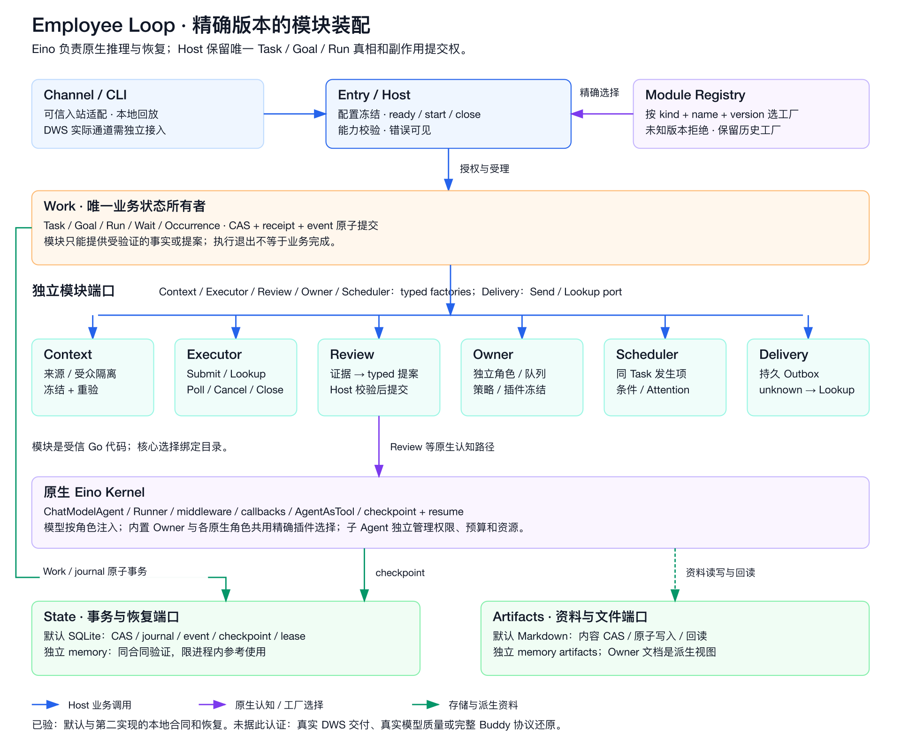

# Composing the local Host

The native Eino runtime and the business Host are separate. Eino runs cognition
and continuations; one `work.Manager` owns Task/Goal/Run transitions. A module is
trusted compiled Go code, not a downloadable script selected by JSON.



## Select exact implementations

`Profile.Modules` selects independent Storage, Context, Executor, Review, Scheduler
and Owner implementations. Omitted references select `builtin@1`; an explicit
unknown name/version fails before workers start. `entry.ModuleRegistry` has typed
`RegisterStorage`, `RegisterContext`, `RegisterExecutor`, `RegisterReview`,
`RegisterScheduler` and `RegisterOwner` methods. Duplicates and builtin overrides
are rejected. Existing `Models`, `Delivery`, `Callbacks` and `Plugins` remain the
model, delivery and native extension ports.

For example, an embedding Host can use the independent memory adapter:

```go
registry := entry.NewModuleRegistry()
ref := entry.ModuleRef{Name: "memory", Version: "1"}
err := registry.RegisterStorage(ref, func(ctx context.Context, opts entry.Options) (storage.State, storage.Artifacts, error) {
    return memory.New(), memory.NewArtifacts(), nil
})
if err != nil { return err }
profile.Modules.Storage = ref
runtime, err := entry.Open(ctx, entry.Options{
    Directory: privateDir, Profile: profile, Models: models, Modules: registry,
})
```

Imports are `github.com/D1-2004/eino-employee-loop/{entry,storage,storage/memory}`.
Memory is process-local reference storage. It does not provide crash durability
or coordination across independent processes. The default SQLite/Markdown adapter
continues to provide the persistent local runtime.

## Keep authority in the Host

| Port | Replacement supplies | Host retains |
| --- | --- | --- |
| State / Artifacts | Transactional CAS, atomic event/receipt writes, scoped checkpoints and fenced leases; conditional file writes | One business aggregate and effect identity; projection verification |
| Context | Admit/read/build/revalidate and explicit audience checks | Trusted identity and audience grant; no inference from scene names |
| Executor | Submit/Lookup/Poll/Cancel/Close facts on one Run | Request snapshot, unknown handling, Run/Goal ownership, artifact and result checks |
| Reviewer | Typed proposal from the frozen Task and verified frame | Source/permission/revision checks and `ApplyReview` commit |
| Owner | Observe/Tick/Documents for the selected version | Frozen profile, sources and role policy; native extension composition |
| Scheduler | Conditions/occurrences/attention on existing Work | Same Task aggregate, occurrence and authorization contracts |
| Delivery | Send/Lookup receipts | Durable intent, unknown lookup obligation and accepted outcome |

`ModuleDependencies` provides the shared State/Artifacts/Work, Context,
authorization, frozen Profile, models/options and optional local native Run
function. An independent remote Executor does not call that Run function. It
must be an atomic execution service, not a second business Task/Goal API.

A Reviewer only returns a proposal. The Host checks its original Task revision,
Goal revision and Run ID, revalidates the input, then applies the proposal. An
execution summary or provider exit alone is not evidence of business completion.
Trusted factories must supply their actual business review policy.

The builtin Owner uses independent native agents. Custom roles can be assembled
with `ownerloop.Options.RolePolicies` inside an exact-version Owner factory;
selected policy text is frozen in the observation. A profile role must be
registered by that selected Host implementation. No arbitrary role is silently
mapped to an existing role.

## Recovery, resources and migration

Storage/Context/Executor/Scheduler selection is bound to the private directory in
`module-selection.json`, independently of the chosen State adapter. Changing that
selection requires an explicit migration. The first Open reserves this selection
even if later initialization fails; retry the same selection or use a fresh
private directory after inspecting the failed initialization. Changing the storage provider cannot
hide the original binding. Existing unmanifested builtin directories can continue
with builtin modules; this does not authorize automatic conversion to a new store.

Review and Owner resolve from each work item's frozen profile, including old
versions after reopening with a newer profile. Keep old factories available until
that work drains. Missing factories fail explicitly; there is no latest-version
fallback, hot unload or automatic migration. Factories for old and new Owner
versions continue to tick their own queues.

Factories are ready before workers start. Entry stops and joins workers/explicit
operations before closing modules, then Artifacts, the leadership lease and State.
Module implementations with resources implement `io.Closer`; Entry owns their
close, including partial initialization failures. They must not close shared
State/Artifacts. Review resources are scoped to one proposal.

A custom complete Backend declares `Capabilities() []entry.Capability`. Entry
checks declarations against implemented operations and `RequiredCapabilities`
before acceptance. Unsupported Schedule, Signal, Owner, Retry and Diagnostics
return `entry.ErrUnsupported`; unsupported diagnostics are not an empty success.

## Audience and plugins

Owner projections are evidence-cited views. By default only same-scene evidence
may enter a model. An injected `AudiencePolicy` can explicitly allow transfers
within the same workspace/tenant/employee/requester; it cannot override those
mandatory boundaries. A mixed document with any unauthorized evidence is omitted
whole. Old frozen files without audience-bound evidence fail closed. Withdrawal
and grant changes are checked again on recovery and immediately before external
Executor submission.

`Profile.Plugins` applies to builtin Owner agents as well as ordinary native
roles. CLI `-list-plugins` discovers compiled plugins; `audit@v1` emits structural
lifecycle metadata to stderr without messages, outputs or credentials. Plugin
factories remain trusted Go: ReadOnlyAgents is not a sandbox, and child agents
need their own scoped models, budgets and cleanup. See [plugin contract](specs/plugins.md).

## Verification and remaining scope

Conformance checks exercise actual SQLite/Markdown and independent memory state,
real Entry file effects, native checkpoints, independent Executor/Reviewer/Owner
implementations, old versions and rejection cases. Scripted models make these
mechanism checks deterministic; they do not certify real-model quality, actual
DWS delivery or full Buddy protocol parity. Rich DWS delivery, platform identity,
source reading, budget/finalization and typed business waits remain separate work.

Native composition follows Eino's [ChatModelAgent](https://www.cloudwego.io/docs/eino/core_modules/eino_adk/agent_implementation/chat_model/)
and [Runner/extension](https://www.cloudwego.io/docs/eino/core_modules/eino_adk/agent_extension/)
contracts, checked against the pinned v0.9.21 source. No custom JSON workflow
interpreter is introduced.
