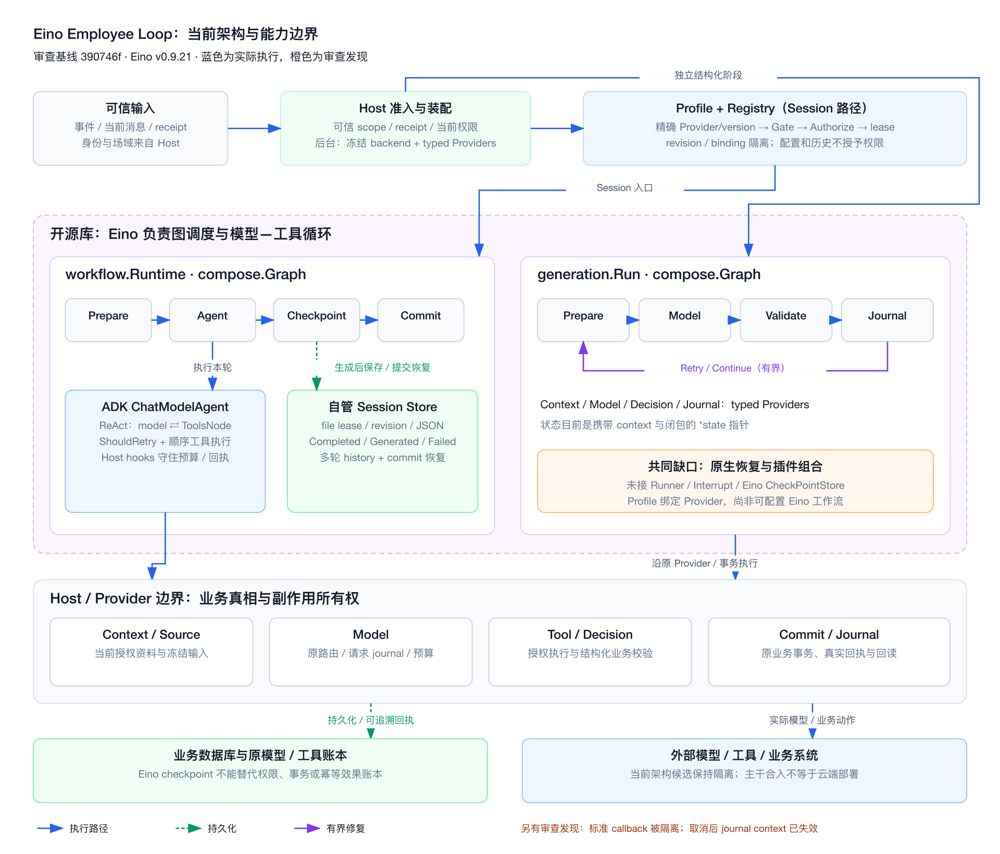

# Eino 特性使用深度审查（2026-10-24）

审查代码：[`390746f23daf`](https://github.com/D1-2004/eino-employee-loop/commit/390746f23daf83dce03ebf1a1b3d0969d458c626)，Eino 固定版本 **v0.9.21**。该提交已由 Git Data API 快进到 `main`，PR #4 已 merged。本文是合入后的独立能力审查；不把此前行为对齐通过当作架构充分利用的证明。本轮未修改运行时代码或部署服务。



[SVG 原图](../architecture/eino-architecture.svg)

## 结论

**已经实际使用 Eino 的模型—工具执行和图调度；运行时恢复、观测与插件组合尚未充分接入 Eino。** 适合定位为“保持旧 Host 合同的 Eino 执行内核与隔离适配”，目前不能定位为“以 Eino 原生状态和中断机制实现的可恢复 Agent Runtime”。两者的差别会影响插件复用、HITL 和后续维护。

这不是要求把每个 Eino API 都用一遍：权限、来源、租约、物理预算、模型请求 journal 与真实工具回执必须继续归 Host；Eino 原生 checkpoint 也不提供外部业务副作用 exactly-once。近期行为的逐条对齐和框架能力的复用属于两个不同验收维度。

## 发现（按处理优先级）

### R1 · P2 · 取消后的 Journal 没有可用的落盘 context（已复现）

位置：[generation/graph.go:104–115](https://github.com/D1-2004/eino-employee-loop/blob/390746f23daf83dce03ebf1a1b3d0969d458c626/generation/graph.go#L104-L115)。

图调度用了 `context.WithoutCancel(ctx)`，但 `save` 把原先的 `s.ctx` 传给 `Journal.Save`。若模型返回时原 context 已取消，图仍会进入 journal 节点，遵循 context 的数据库/存储却会立即拒绝写入。已有取消测试的 Journal fake 忽略 context，所以只证明“调用过 Save”，没有证明“保存成功”。

确定性探针：[probes/cancel/main.go](probes/cancel/main.go)，无真实模型或外部系统调用：

```sh
go run ./docs/reviews/probes/cancel
```

实际结果：`model_calls=1`、`journal_invocations=1`、`persisted_attempts=0`、`accepted=false`，已返回的 response 仅留在当前进程的 Result 中。它不证明重复业务副作用；具体消费方可能已经在 Model 内落原始账本或另行结算预算，但泛型 Journal 的取消结算语义不完整。

建议：仅为已预留尝试的 Journal 结算提供有期限的独立保存 context，类似 `workflow.checkpoint` 的做法；原取消仍须返回给调用者，不再生成、不接受决策、不执行新业务动作。补充真正检查 `ctx.Err()` 的存储反例，再验证消费方没有忽略传入的新 context。

### R2 · P2 · Graph 节点 context 在进入 Provider 前丢失（已复现）

位置：[generation/graph.go:69–109](https://github.com/D1-2004/eino-employee-loop/blob/390746f23daf83dce03ebf1a1b3d0969d458c626/generation/graph.go#L69-L109)、[workflow/runtime.go:158–160](https://github.com/D1-2004/eino-employee-loop/blob/390746f23daf83dce03ebf1a1b3d0969d458c626/workflow/runtime.go#L158-L160)。

generation 节点忽略 Eino 传入的 context，改用私有 `state.ctx`；workflow 的 Lambda 则闭包捕获外层 context。Eino callback 在节点上建立的 trace/span 或 middleware context 不能自然传入实际 Provider。图调度可见，实际模型/存储调用却可能脱离对应节点的父级上下文；未来插件依赖 context 扩展时同样受限。

探针：[probes/context/main.go](probes/context/main.go)：

```sh
go run ./docs/reviews/probes/context
```

实际结果：图 callback 启动 5 次，但 `prepare_received_node_context=false`、`model_received_node_context=false`，生成本身成功。不是笼统推测“观测可能有问题”。

建议：把 Eino 节点 context 作为扩展/观测上下文，独立保留原业务取消和 deadline。需要明确派生/合并规则，不能简单把所有调用改用 `WithoutCancel` 而让业务动作忽略取消。

### R3 · P2（生态接入缺口）· 标准 callback、事件与 middleware 入口被屏蔽

位置：[loop/loop.go:204–241](https://github.com/D1-2004/eino-employee-loop/blob/390746f23daf83dce03ebf1a1b3d0969d458c626/loop/loop.go#L204-L241)、[loop/adk_test.go:157–205](https://github.com/D1-2004/eino-employee-loop/blob/390746f23daf83dce03ebf1a1b3d0969d458c626/loop/adk_test.go#L157-L205)。

`InitCallbacks(..., nil)` 会替换传入 handlers；provider/hostTool 声明自行实现 callbacks；`agent.Run` 事件只保留 `Err`，没有向外暴露事件流。测试明确断言外部 context handlers 看不到 ADK 图。这是兼容旧行为的有意选择，不是偶发失效，但意味着外部 Eino tracer、AgentTool 的内部事件和标准 middleware 不能直接组合进来。目前只有自定义 `OnModelCall`/`OnToolCall` 等 hooks。

建议：为新版本候选提供显式的、可冻结的 Eino handler/事件 adapter seam；对已校验的事件做投影，绝不能直接把未校验的 assistant/tool 内容作为公开回复。保留历史默认隔离行为，避免双份模型/工具 span 和重复业务回执。先在一个只读观测插件上验收，再决定是否扩大接口。

### R4 · 重要架构缺口 · Session/提交恢复不能替代 Eino 原生 Interrupt/Resume

位置：[loop/loop.go:235](https://github.com/D1-2004/eino-employee-loop/blob/390746f23daf83dce03ebf1a1b3d0969d458c626/loop/loop.go#L235)、[workflow/runtime.go:149–177](https://github.com/D1-2004/eino-employee-loop/blob/390746f23daf83dce03ebf1a1b3d0969d458c626/workflow/runtime.go#L149-L177)、[workflow/runtime.go:199–239](https://github.com/D1-2004/eino-employee-loop/blob/390746f23daf83dce03ebf1a1b3d0969d458c626/workflow/runtime.go#L199-L239)。

当前直接 `ChatModelAgent.Run`，没有 `Runner.CheckPointStore`、`WithCheckPointID`、`ResumeWithParams`，compose 也没有绑定原生 CheckPointStore。名为 `checkpoint` 的节点是一次 wake 生成结束后的自管 JSON 保存，不是 Eino 执行位置 checkpoint。多轮历史、完成重放、生成后提交失败恢复已经实现；模型/工具执行中途挂起后原地恢复、targeted resume 和跨子 Agent 的中断还没有实现。`Waiting` 是 Host 的业务终态，新回答开启下一 wake，并非恢复原 ADK 栈。

另外，generation 的 state 含 `context.Context`、Provider 和函数闭包，workflow execution 含 lease、Provider、Model/Host 等运行对象。给当前图加一个 `WithCheckPointStore` 并不能自动把这些对象变成稳定的可序列化 continuation。

建议：先定义一种确实需要同一 continuation 的等待场景，再把可序列化状态与运行句柄分开，通过 Runner/原生 checkpoint 对接 Host 的 scoped Store 和 effect journal。业务 Task 等待仍可留在 Host，不能把所有跨日业务调度都迁给 ADK。验收应证明“进程重建后从指定中断点继续、已完成工具不重复”，而非只测历史问答。

### R5 · P2（扩展边界）· Profile 是 Provider 绑定配置，尚非 Eino 工作流组合配置

位置：[workflow/profile.go:16–29](https://github.com/D1-2004/eino-employee-loop/blob/390746f23daf83dce03ebf1a1b3d0969d458c626/workflow/profile.go#L16-L29)、[generation/graph.go:34–60](https://github.com/D1-2004/eino-employee-loop/blob/390746f23daf83dce03ebf1a1b3d0969d458c626/generation/graph.go#L34-L60)。

Profile 只绑定 Provider/version/lane/session。两种图的节点拓扑在代码内固定；没有只读 middleware、子图工厂或 AgentAsTool 的注册/组合接口。增加新能力通常要新增整套 Provider 或继续给 `loop.Config` 增加专有 hook；无法仅通过现有 Profile 给一个 Agent 组合标准 Eino 处理器或子图。

当前精确版本注册、未知插件拒绝和配置隔离是正确基础。没有必要引入任意脚本/远程插件 URL，也没有理由把独立后台模块强制组成 Supervisor。

建议：选择一个最小的代码注册扩展点（例如只读观测 middleware 或无副作用的子图），让 Profile 仅选择已注册且版本化的工厂，再让产物进入 Eino 标准组合接口。不要先造一套通用 JSON 工作流 DSL。

## 已经用对的部分

| Eino 能力 | 当前使用情况 | 判断 |
| --- | --- | --- |
| ChatModelAgent / ReAct | 实际驱动模型与 ToolsNode，非只在外层引用包 | 使用有效 |
| ModelRetryConfig / ShouldRetry | 由 ADK 调度重试，Host 校验结果、冻结语义和物理上限 | 合理保留领域规则 |
| ToolsNode | 显式顺序执行，防止未知/重复效果；支持受控 unknown handler | 不应为了“用并行”破坏原顺序 |
| compose.Graph / Branch | generation 真实通过 journal → prepare 回边组织 Retry/Continue，并有步数上限 | 使用有效；不是手写 for 包一层图 |
| typed Model / Tool 边界 | 公共 Eino model/tool 接口对接原 Host | 适合解耦 |
| Session / effect 所有权 | 版本、scope、lease、receipt 和旧账本留在业务侧 | 不应被 Eino 原生状态替代 |

## 推荐处理顺序与验收

1. **先处理 R1 的取消结算合同及 R2 的 context 传递**：确定性探针可直接验收，不需要真实业务写入。保持取消失败、不增加模型调用或业务效果。
2. **开放一个受控 Eino 观测扩展**：节点/模型/工具 trace 能串起来，原回执只记一次，历史 reader 字节与默认 callback 行为保持不变。
3. **按一个真实等待场景接 Runner + checkpoint**：序列化 continuation 与运行对象分离，保持原授权、schema/version 和幂等账本。
4. **再考虑插件组合**：用一个已注册子图或 middleware 验证接口，按实际需求接 AgentAsTool；独立加工模块仍独立。

本轮为审查与图文交付，没有将上述建议静默实现或部署。此前局部行为对齐验收仍成立；此次补充的是新复现的 journal/context 问题及原生运行时能力的明确缺口。它们不能被“61 场景一致”或一次真实模型成功覆盖。

## 核验与官方依据

- `go test ./...` 通过；标准 callback 隔离的两个现有测试定向通过。两个本地探针的实际结果见 R1/R2。
- API 以本机已固定的 Eino **v0.9.21** 源码逐项核对：`adk/runner.go`、`adk/handler.go`、`adk/turn_loop.go`、`adk/agent_tool.go`、`compose/checkpoint.go`、`compose/generic_graph.go`、`callbacks/aspect_inject.go`。新版文档提到的接口未直接当作当前实现。
- [官方 Runner 与扩展](https://www.cloudwego.io/docs/eino/core_modules/eino_adk/agent_extension/)：生命周期、checkpoint 与 interrupt/resume 的职责。
- [官方 Graph checkpoint](https://www.cloudwego.io/docs/eino/core_modules/chain_and_graph_orchestration/checkpoint_interrupt/)：节点恢复、序列化注册和 CheckPointStore。
- [官方 ChatModelAgent](https://www.cloudwego.io/docs/eino/core_modules/eino_adk/agent_implementation/chat_model/)：handler、模型/工具调用链与 AgentAsTool。
- [官方 HITL 架构](https://www.cloudwego.io/docs/eino/core_modules/eino_adk/agent_hitl/)：显式目标恢复，不能与普通下一轮历史拼接混为一谈。
