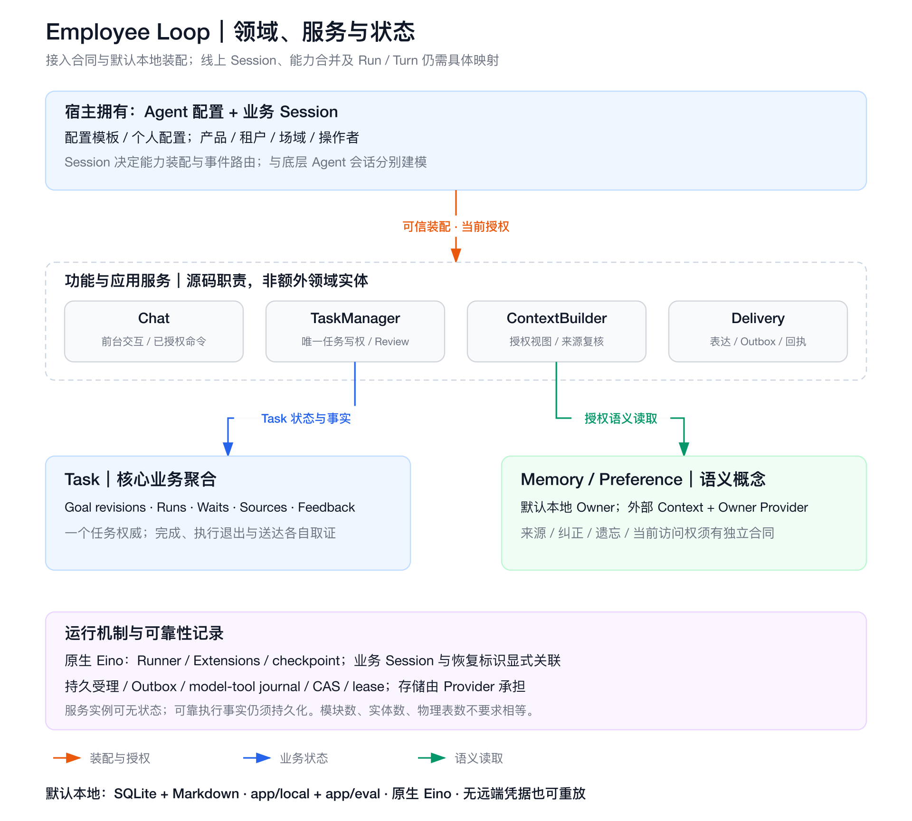

# Domain model and Host assembly

Business entities, application services and durable execution records are three
views of one system. Source directories describe code ownership; they do not
imply one additional entity, database or service deployment per directory.

## Entities and authority

| Concept | Authority / meaning | Current SDK mapping |
| --- | --- | --- |
| Agent definition/configuration | Host manages reusable defaults and allowed personal configuration | A frozen `contract.Profile` is the local assembly snapshot, not a general Agent-management API. |
| Business Session | Host-defined capability assembly and event-routing scope, related to product/tenant, scene and authenticated operator | Trusted application code maps to an accepted Profile/Scope. No universal Session ID format or registry is prescribed. |
| Task | One durable business aggregate for accepted delegated work | `task/state.Task`, with Goal revisions, Runs, Waits, original sources and feedback facts. |
| Run | A particular authorized execution attempt within a Task | Existing frozen execution binding, submit identity, actual exit and Review rules remain authoritative. |
| Memory / Preference | User-scoped semantic records, with sources, corrections, versions and current access | Local Owner projections are a reference. External semantic storage is supplied by compatible Context and Owner Providers. |
| Source / event | An attributed external fact or trigger | `contract.Input` is the reference human-input admission, not a general platform event schema. Task signals/schedules have their own explicit contracts. |

A business Session is not an Eino session/checkpoint, a transport connection or a
Task. A Host may relate these IDs explicitly. Such a relation never implicitly
grants cross-scene data access, changes the original delivery target or merges
another operator's credentials. Run vs framework Turn and the boundary for human
confirmation must be mapped against the actual provider; there is no global
Run=Turn rule or persisted-format migration in this contract.

## Services and durable records

Chat, TaskManager, ContextBuilder, Owner processing and Delivery are responsibilities.
Entry assembles them; Eino runs cognition. They act on entities and evidence;
adding a module does not create another source of business truth.

An independently restartable service instance can borrow state through Providers.
It still needs durable admission/inbox records, Outbox intents and receipts,
checkpoints, model/tool journals and fenced leases. These are reliability records,
not competing Task aggregates. A committed delivery receipt remains true after
permission is revoked. A checkpoint does not establish business completion.

Keep personal semantic Attention/Preference distinct from an authorized Task's
Wait/Watch/Occurrence and the physical event subscription. Externalizing Memory
storage does not erase these concepts or move business decisions into a database.
A Context read adapter alone cannot redirect the local Owner's writes: replace
both compatible module Providers, or keep the documented local reference.

## Standalone assembly boundary

The standalone Entry opens one immutable Profile: one Owner and an explicit set
of Scenes. `Profile.Scope(scene)` sets Requester to that Owner; admission rejects
another Actor. `Input.Native` is captured data, not a way to override identity or
install a new Session. Dynamic group actors, new scenes and multi-level capability
assembly are Host integration work; they are not enabled by accepting arbitrary
requester strings or changing a scene name.

The Host resolves configuration and permitted capability composition before
opening this reference. Keep authenticated operator, represented user, execution
principal and delivery principal distinct. Personal connector additions and
shared capabilities need explicit Host policy; configuration composition alone
is neither a universal intersection algorithm nor an authorization grant.
Frozen configuration preserves reproducibility; current permission can narrow
what that frozen work may still use.

### Current-scope authorization

`entry.Options.AuthorizeScope` optionally supplies a live Host check for the
standalone backend. Existing static workspace/tenant/employee/Owner/Scene checks
run first; the callback can narrow that boundary, never widen it. With no callback
the explicit local Profile remains the authority, preserving offline local/eval.
The callback is application-owned, receives the operation context and trusted
Scope, must be concurrency safe and honor cancellation, and is not serialized in
a Profile or checkpoint. Reopening attaches the current Host checker to old work.
Opening the reference does not perform a credential or network preflight.

Existing module admission/use/recovery and borrowed Host service clients consult
the current checker. Injected read Providers are checked before the call and
before releasing results. A denied post-effect check returns an error and only a
real committed receipt, rather than exposing revoked content or declaring that
the operation never happened. A permission error is a hard error, not a
correctable no-effect tool refusal.

This gate checks the Scope. Resource/tool/action authorization, opaque bindings,
credential issuance and capability merge remain the responsible Provider/Host's
work. It does not forcibly cancel an already running remote process or erase
existing effects. Source revocation, audience and delivery-target checks remain
separate. Complete external business backends own their authorization contract;
using this standalone-only option with them is rejected explicitly.

## Storage follows access patterns

First define Task identities, relationships, revisions and transitions. Then list
real reads: exact Task/Run, requester/scene task lists, ready/due work, pending
Waits, frozen sources, reviewed outcomes and delivery receipt lookup. Only then
choose physical tables and query projections. An index/projection is not a new
business aggregate; one aggregate does not require a single physical table.

SQLite/Markdown remains the default local composition. A production Provider may
use different tables/queues but must preserve transactions, CAS, event/receipt
atomicity and fencing. Add bounded hot-query projections when measured access
requires them; do not copy a server's whole schema or turn each code module into
a table merely to match its name.

## Integration acceptance still needed

A real Host integration must exercise its authenticated event → configuration
assembly → original Task → actual execution → reviewed outcome → exact delivery
receipt path. Include the same group with two operators and different personal
connectors, permission revocation, restart, late answers and unknown outcomes.
Local tests establish reference boundaries, not a deployed Host's wire, event SLA,
capability merge, external Memory semantics or live IM behavior.
